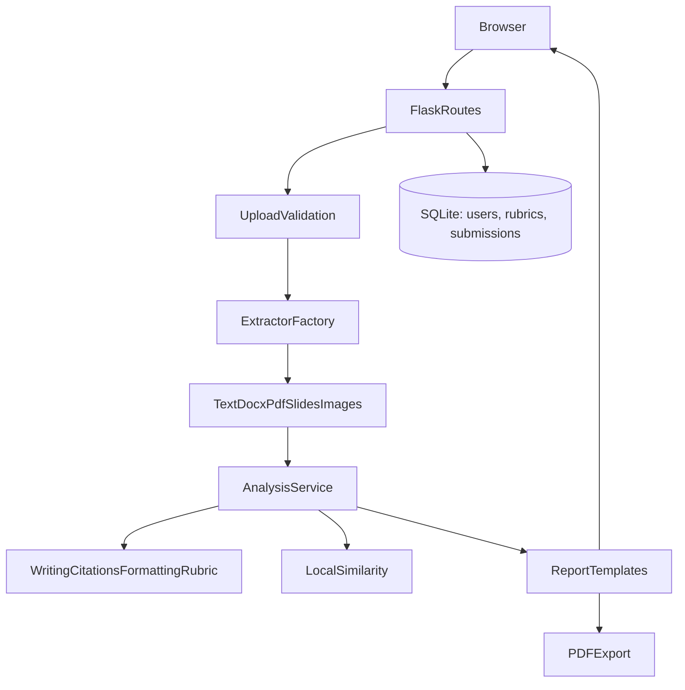

# Assignment Quality Analyzer

[](https://github.com/Sanjeewa08/AssignmentQualityAnalyzer/actions/workflows/tests.yml)

A Flask web app that helps students and lecturers review assignment clarity, structure, citations, formatting, and requirements. Its output is an explainable revision checklist—not a grade, authorship claim, or misconduct finding. It never rewrites student work.

## Features

- TXT, DOCX, text/scanned PDF, PPT, PPTX, JPG/JPEG, and PNG extraction through extension-routed extractor classes.
- Local OCR for images and scanned PDFs (Tesseract + Poppler); optional LibreOffice conversion for legacy PPT.
- Legacy `.ppt` is offered only when LibreOffice is installed; `.pptx` remains available without it.
- Word, character, sentence, and paragraph counts; minimum/maximum word requirements.
- Flesch, Flesch-Kincaid, and Gunning Fog scores with plain-language interpretation.
- Structure/headings, basic APA/MLA citation signals, and DOCX font/spacing/margin checks.
- Spelling flags, optional local LanguageTool grammar checking, long sentence/passive-voice/repetition signals.
- TF-IDF similarity to the 25 most recent locally stored submissions and optional reference text, plus bounded sentence-level overlap leads.
- Explainable AI-style heuristic signals, clearly disclaimed as unreliable for authorship assessment.
- Lecturer-defined rubrics, per-category/overall checklist scores, highlighted issue snippets, PDF reports, submission history, and score trend chart.
- Student/lecturer roles, password hashing, CSRF protection, upload size limits, private reports, and temporary-upload cleanup.
- Bootstrap responsive layout and a persisted light/dark theme toggle.

## Screenshots

Add screenshots after running the application:

| Upload | Analysis report | History and progress |
|---|---|---|
| `docs/screenshots/upload.png` | `docs/screenshots/report.png` | `docs/screenshots/history.png` |

## Architecture



## Setup

Python 3.10+ is recommended.

### Windows PowerShell

```powershell
py -m venv .venv
.\.venv\Scripts\Activate.ps1
python -m pip install --upgrade pip
python -m pip install -r requirements.txt
Copy-Item .env.example .env
python run.py
```

Open `http://127.0.0.1:5000`, register a student account, then upload an assignment. Set `AQA_SECRET_KEY` in `.env` before exposing the app beyond local development.

### Hugging Face Spaces (Docker)

Create a Docker Space and deploy this repository. The Docker image installs Tesseract and Poppler and serves the Flask app with Gunicorn on port 7860. Set `AQA_SECRET_KEY` as a Space secret; the database tables are created automatically on first startup. Legacy `.ppt` uploads are disabled in this image because LibreOffice is not installed; save those files as `.pptx`.

### OCR and optional services

- **Tesseract OCR:** install the Tesseract executable and language data for your OS; ensure `tesseract` is on `PATH`. On Windows, set `TESSERACT_CMD` in `.env` to its full executable path if needed.
- **Scanned PDF:** install Poppler and ensure `pdfinfo`/`pdftoppm` are available on `PATH`. `pdf2image` uses these system tools.
- **Legacy `.ppt`:** install LibreOffice and make `soffice` available on `PATH`. `.pptx` does not require LibreOffice.
- **LanguageTool:** grammar checking uses lightweight local rules by default. To enable the optional `language_tool_python` local Java-backed checker, install a supported Java runtime and set `AQA_LANGUAGE_TOOL=true`. This may download a local LanguageTool distribution on first use.
- PDF export uses ReportLab and does not require a system PDF utility.

If optional system tools are unavailable, the app gives a friendly explanation for the affected format; it does not upload assignment content to an external extraction service.

### Lecturer accounts

Student registration cannot assign lecturer privileges. Create a lecturer from the command line:

```powershell
python -m flask --app run.py create-lecturer
```

The CLI prompts for the account email and password. Lecturers can create rubrics using one criterion per line. Supported automatic checks include `must include a conclusion`, `min 1500 words`, and `min 5 references`; other criteria are explicitly marked for lecturer review.

## Run and verify tests

```powershell
python -m pytest
```

Pytest runs unit/integration tests with coverage enforcement at 80%. The Playwright end-to-end test uploads a file in Chromium; install its browser once using:

```powershell
python -m playwright install chromium
```

The browser test skips with setup guidance if Chromium is unavailable. CI installs Chromium and runs the complete suite and coverage check on pushes and pull requests.

Sample assignments for local tests are in `tests/test_data/`.

## Project layout

```text
app/
  analyzers/      writing, citations, originality, formatting, rubric checks
  extractors/     factory and TXT, DOCX, PDF, slides, image extractors
  models/         SQLAlchemy User, Submission, Rubric models
  services/       report assembly and scoring
  static/         responsive styles and upload/theme interactions
  templates/      upload, auth, report, history, rubric pages
tests/
  browser/        Playwright UI flow
  test_data/      sample good/bad assignments
  test_*.py       unit and Flask integration tests
```

## Privacy, ethics, and limitations

- Reports and extracted content are stored in local SQLite for the signed-in user's history and local comparison. Other local submissions may be compared for possible overlap; this is not internet plagiarism search. Plan retention and database encryption for deployments containing real student work.
- Uploaded files are held in a temporary local path and deleted after extraction/analysis, including error paths. Extracted assignment text remains in the submission database until that record is removed.
- AI-style, passive-voice, grammar, citation, readability, section, and similarity indicators can be wrong—especially for multilingual text, unconventional formats, or short assignments. They are not proof of authorship or misconduct.
- Citation checks are pattern-based and do not validate references against authoritative bibliographic databases. Formatting guidance is not a substitute for course instructions.
- Rubric automatic checks are intentionally narrow; qualitative criteria require lecturer review.
- Bootstrap and Chart.js are loaded from public CDNs. Deployments requiring offline use should vendor these assets locally.
- Before production use, configure a strong secret, HTTPS, database backups/retention, rate limiting, privacy notices, and appropriate institutional review. This repository is a functional educational app, not a hosted multi-tenant compliance service.

## Future work

Institution-specific citation profiles, administrator-managed retention, rubric scoring workflows, database migrations, richer language support, and configurable local OCR languages.
